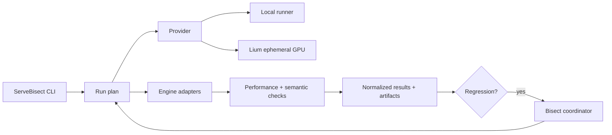

# ServeBisect

ServeBisect is an open-source regression lab for GPU inference systems. It is designed to help maintainers answer a concrete question with reproducible evidence:

> What changed between a known-good build and a suspected-bad build, and does the change affect speed, API behavior, or model output?

ServeBisect brings performance comparison, semantic output checks, OpenAI-compatible API conformance, environment capture, and regression bisecting into one workflow. It can run locally and is designed to use ephemeral GPU machines for clean reproduction runs, with Lium as the first provider integration.

The project is an early PoC. Treat the current CLI and provider support as experimental while the public workflow is being hardened.

## What ServeBisect is for

Inference regressions are often hard to reproduce because several things change at once: engine versions, kernels, CUDA libraries, drivers, model revisions, GPU types, and serving defaults. A server can also remain healthy while throughput drops or response semantics change.

ServeBisect aims to make those failures easier to turn into maintainer-ready evidence:

- compare two engine/version configurations on the same workload;
- detect performance deltas such as throughput or latency regressions;
- compare boolean semantic checks emitted by baseline/candidate harnesses;
- probe OpenAI-compatible chat, streaming, tool-call, and JSON-output behavior;
- capture the machine, GPU, driver, package, and run configuration alongside results;
- reproduce tests on a clean ephemeral GPU;
- bisect a local git revision range to narrow a metric regression;
- emit machine-readable artifacts that can be attached to an issue or CI run.

ServeBisect does not try to replace engine-specific benchmark suites. It focuses on the loop around them: reproduce, compare, isolate, and report.

## Quick start

ServeBisect targets Python 3.11+ and is intentionally dependency-light.

From a source checkout:

```bash
python -m venv .venv
source .venv/bin/activate
python -m pip install -e .

servebisect --help
```

Run the deterministic built-in demo first. It creates a temporary git repository, introduces a synthetic throughput regression across revisions, and asks ServeBisect to locate the first bad commit:

```bash
servebisect demo \
  --json /tmp/servebisect-demo.json \
  --markdown /tmp/servebisect-demo.md
```

The repository also includes a local baseline/candidate example:

```bash
servebisect run examples/servebisect.toml
```

That example intentionally crosses its `tokens_per_second` regression budget, so `servebisect run` prints a `REGRESSION` report and exits with status `1`. The benchmark contract is deliberately simple: each command prints a JSON object containing `metrics`, `checks`, or both. For example:

```json
{
  "metrics": {"tokens_per_second": 100.0, "ttft_ms": 80.0},
  "checks": {"tool_calling": true}
}
```

ServeBisect can also bisect a local git repository whose benchmark command emits that contract:

```bash
servebisect bisect \
  --repo /path/to/engine-repo \
  --good <known-good-revision> \
  --bad <known-bad-revision> \
  --command "python benchmark.py" \
  --metric tokens_per_second \
  --direction higher \
  --max-regression-pct 5 \
  --json /tmp/bisect.json \
  --markdown /tmp/bisect.md
```

The current CLI also exposes OpenAI-compatible conformance probes:

```bash
servebisect conformance \
  --base-url http://127.0.0.1:8000/v1 \
  --model Qwen/Qwen3-8B \
  --json /tmp/conformance.json
```

The built-in suite currently checks basic chat shape, JSON-object output, forced tool calls, and SSE stream termination. Use repeated `--check` flags to run a subset.

For a small streaming performance sample against the same API surface:

```bash
servebisect benchmark \
  --base-url http://127.0.0.1:8000/v1 \
  --model Qwen/Qwen3-8B \
  --requests 8 \
  --concurrency 2 \
  --max-tokens 128 \
  --json /tmp/benchmark.json
```

The benchmark reports request throughput, success rate, latency p50/p95, TTFT p50/p95, and completion-token throughput when the server supplies streamed usage data. It is intentionally a lightweight regression probe rather than a replacement for an engine's full benchmark suite.

For vLLM and SGLang, `serve-command` prints a launch command without starting the server:

```bash
servebisect serve-command --engine vllm --model Qwen/Qwen3-8B
servebisect serve-command --engine sglang --model Qwen/Qwen3-8B
```

Use `servebisect --help` and subcommand help for the exact current interface. The project is alpha and flags may still change while the workflow settles.

## Ephemeral GPU runs with Lium

ServeBisect is designed so GPU allocation has a bounded lifecycle. Lium's current CLI supports a non-interactive workflow suitable for this:

```bash
# 1. Discover rentable nodes as JSON. The `id` field is the safest input to `lium up`.
lium ls --format json

# 2. Rent a node without opening SSH and attach an automatic TTL.
lium up <node-id> \
  --count 1 \
  --yes \
  --no-ssh \
  --ttl 45m \
  --name servebisect-run

# 3. Find the resulting pod and inspect its price / scheduled removal.
lium ps --format json

# 4. Run a non-interactive command and request structured output.
lium exec <pod> --json "nvidia-smi"

# 5. Tear down explicitly as soon as the run finishes.
lium rm <pod>
```

`lium up` currently has no JSON output mode, so automation should read the pod back with `lium ps --format json`. A TTL is a cost backstop rather than a substitute for teardown: ServeBisect should still remove the pod in a `finally`-style cleanup path and verify that it is gone.

See [docs/lium.md](docs/lium.md) for a complete provider workflow and [docs/security-and-cost.md](docs/security-and-cost.md) for guardrails.

The current PoC wraps that lifecycle with:

```bash
# Verify the CLI/account and show up to ten cheapest matching nodes.
servebisect lium doctor --gpu H100 --count 1

# Rent the cheapest matching node, optionally set it up, run one command,
# and remove the pod in a finally-style cleanup after a successful rent.
servebisect lium run \
  --gpu H100 \
  --count 1 \
  --ttl 45m \
  --max-hourly-price 3.00 \
  --setup "python -m pip install -U vllm" \
  --command "nvidia-smi"
```

The wrapper requires a scriptable Lium CLI (`>=0.0.42`), refuses the cheapest matching node when it exceeds `--max-hourly-price`, reconciles a named pod after a failed `lium up`, and verifies removal with fresh `lium ps --format json` state. A total-run spend ceiling, periodic spend polling, and controller-crash orphan reconciliation remain roadmap work before treating the provider path as shared unattended CI infrastructure.

`servebisect lium compare` additionally keeps a baseline/candidate pair on the same ephemeral pod and can upload local benchmark files with `--upload LOCAL:REMOTE`. The first checked-in public regression case uses this path; see [`cases/vllm-49013`](cases/vllm-49013/README.md).

## Architecture



The architecture keeps four concerns separate:

1. **Run/config** describes baseline and candidate benchmark commands plus metric budgets.
2. **Providers** acquire an execution target and expose a small command lifecycle.
3. **Checks and engine adapters** probe OpenAI-compatible behavior or generate engine launch commands without owning infrastructure.
4. **Reports and bisecting** compare structured results and choose the next candidate revision.

That separation keeps local reproduction useful even without cloud credentials and makes provider failures distinguishable from product regressions.

More detail is in [docs/architecture.md](docs/architecture.md).

## OpenAI-compatible conformance

Semantic regressions can be just as damaging as throughput regressions. The current conformance suite probes:

- ordinary chat-completion response shape;
- JSON-object response formatting;
- forced tool-call shape and JSON arguments;
- SSE chunks and a terminal `data: [DONE]` event.

The roadmap expands this toward finish reasons, stricter structured-output schemas, parallel tool calls, reasoning-field compatibility, cancellation/error behavior, and richer raw evidence. The current standalone conformance JSON contains pass/fail details for each probe rather than a full request/response transcript.

## Reproducibility contract

Every useful regression report should make the run reconstructable. Today, local benchmark observations preserve the command, duration, metrics/checks, stdout/stderr, and an environment fingerprint with platform/Python plus NVIDIA GPU identity when `nvidia-smi` is available. The broader reproducibility contract is:

- engine/package version and source revision;
- model identifier and revision when available;
- GPU model/count and relevant machine metadata;
- driver, CUDA/ROCm, Python, and relevant dependency versions;
- exact workload, request corpus, seeds, and comparison thresholds;
- warmup and measured iteration counts for performance checks;
- raw stdout/stderr and structured check output;
- provider/run identifiers that help diagnose infrastructure failures without embedding credentials.

A ServeBisect result should make it possible to distinguish "the candidate is slower" from "the machine, workload, or environment changed."

## Safety and cost defaults

GPU automation needs hard boundaries because a crashed controller can still leave a machine running.

- Require an explicit TTL for every ephemeral GPU rent.
- Prefer node selection from structured output and record the quoted hourly price before allocation.
- Set a run-level maximum spend or maximum duration when the provider surface allows it.
- Remove the pod explicitly on success, failure, timeout, and interruption.
- Verify teardown with a fresh provider listing.
- Keep provider API keys in environment variables or a secret store; never write them into reports, fixtures, commands committed to git, or issue artifacts.
- Treat remote command output as potentially sensitive because model prompts, environment variables, or private repository data may appear in logs.
- Make cloud execution opt-in; local dry runs and plan inspection should not allocate a GPU.

See [docs/security-and-cost.md](docs/security-and-cost.md) for operational detail.

## Project roadmap

The current PoC already provides a local config-driven comparison, deterministic bisect demo, metric-based git bisection, four OpenAI-compatible probes, a streaming endpoint benchmark, vLLM/SGLang launch-command adapters, JSON/Markdown reports, and a bounded Lium lifecycle wrapper. The broader roadmap includes:

- hardening the current local compare/report flows;
- executing and fingerprinting vLLM/SGLang lifecycle end to end;
- expanding the OpenAI-compatible conformance suite;
- attaching provider/cost metadata to reports plus total-run budget and orphan-reconciliation controls;
- package-version bisection in addition to the existing git metric bisect;
- reproducible public case studies for historical regressions;
- richer HTML/JSON reports and artifact bundles;
- CI integration, including a GitHub Action;
- additional accelerator and provider backends after the execution contract is stable;
- a public regression corpus that maintainers can rerun across engine releases.

See [docs/roadmap.md](docs/roadmap.md) for milestones and acceptance criteria.

## Documentation

- [Architecture](docs/architecture.md)
- [Lium provider workflow](docs/lium.md)
- [Security and cost guardrails](docs/security-and-cost.md)
- [Roadmap](docs/roadmap.md)
- [Examples](examples/README.md)
- [Public regression cases](cases/README.md)

## Contributing

The most valuable early contributions are reproducible regression cases. A good case includes a known-good revision, a known-bad revision, a model/workload small enough to rerun, and a concrete expected signal such as throughput, latency, output shape, tool-calling behavior, or structured-output validity.

When sharing results, remove credentials, private prompts, and unrelated user data from artifacts before publication.

See [CONTRIBUTING.md](CONTRIBUTING.md) for the development and regression-case guidelines and [SECURITY.md](SECURITY.md) for the current vulnerability-reporting and execution boundary.

## License

See `LICENSE` in this repository.

## Provider references

The Lium command examples in this repository were checked against the public Lium CLI documentation on 2026-09-17:

- <https://docs.lium.io/developers/cli/reference/up>
- <https://docs.lium.io/developers/agent-scripting>
- <https://docs.lium.io/developers/cli/reference>
