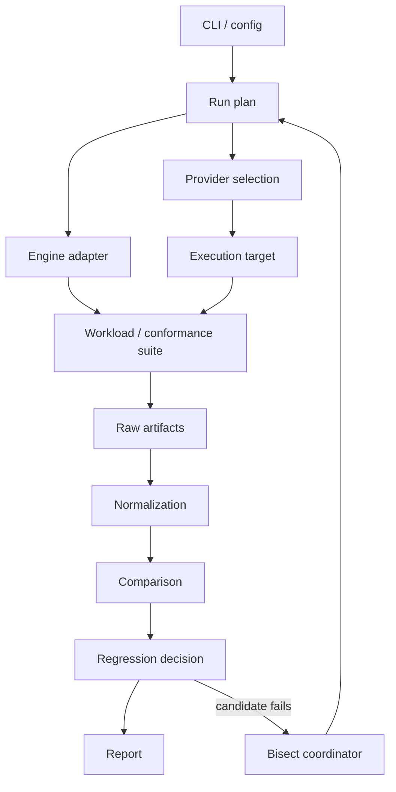

# Architecture

ServeBisect is organized around one repeatable unit of work: execute a test case in a defined environment, collect evidence, normalize the result, and compare it with another run.

The architecture deliberately keeps infrastructure orchestration separate from regression logic. A failed SSH connection, a missing GPU, or a pod that never becomes ready should be reported as an infrastructure failure instead of being interpreted as evidence that an engine revision is bad.

## Current PoC surface

The implementation currently contains these concrete pieces:

- `servebisect run <config.toml>` executes baseline/candidate commands, expects a JSON benchmark payload, applies metric/check rules, fingerprints the local environment, and emits JSON plus Markdown reports;
- `servebisect bisect` uses detached git worktrees to run a metric-producing command across a good/bad revision range without moving the source checkout;
- `servebisect demo` generates a temporary synthetic repository and exercises that bisect path deterministically;
- `servebisect conformance` runs four OpenAI-compatible endpoint probes (`basic_chat`, `json_object`, `tool_choice`, `stream_sse`);
- `servebisect benchmark` sends concurrent streaming chat requests and reports request throughput, latency, TTFT, success rate, and completion-token throughput when usage is available;
- `servebisect serve-command` generates vLLM or SGLang launch commands;
- `servebisect lium doctor/run` wraps structured node discovery, a minimum scriptable CLI version check, hourly-price ceiling, bounded rent, remote execution, failed-rent reconciliation, explicit removal, and removal verification.

Several parts of the fuller architecture below are design targets rather than completed behavior, especially rich run plans, invalid-run-aware bisect retries, full provider metadata in reports, raw HTTP evidence, package bisection, and controller-crash orphan reconciliation.

## Data flow



### Run plan

The current TOML run config contains baseline/candidate commands, optional labels/cwds/timeouts, metric rules, and output paths. A fuller run plan should be serializable and contain enough information to reproduce the test:

- engine and revision or package version;
- model and model revision when pinned;
- provider requirements such as GPU type/count and TTL;
- workload or conformance suite;
- performance thresholds and semantic comparison rules;
- seeds, warmup count, repetitions, timeouts, and concurrency;
- artifact/output directory.

The plan is the stable boundary between the user-facing CLI and the execution machinery. It should be possible to print or validate a plan without allocating a GPU.

### Provider

A provider owns infrastructure lifecycle only. Its responsibilities are intentionally small:

1. discover candidate execution targets;
2. allocate or select one;
3. report immutable identity and pricing metadata where available;
4. run commands and transfer the minimum files needed by the workload;
5. collect provider-specific diagnostics;
6. destroy the target and verify teardown.

Today, local execution goes directly through the benchmark runner rather than a provider abstraction. Lium has a dedicated CLI wrapper for ephemeral GPU allocation. Moving both behind one stable provider interface is a roadmap refinement.

Provider code should never decide whether an engine revision passed a regression threshold.

### Engine adapter

An engine adapter translates a run plan into setup and launch steps for a serving engine. It should expose engine-specific details such as:

- install/build commands;
- server launch command and health probe;
- OpenAI-compatible base URL when applicable;
- engine version/build identity;
- log and configuration artifact locations.

The adapter should record exact commands and resolved versions in the report. Hidden defaults make performance comparisons difficult to trust.

### Checks

Checks consume an execution target plus an engine endpoint or command and return structured observations.

Performance checks can report metrics such as throughput, time to first token, inter-token latency, request latency, or memory use. Semantic checks can report normalized response bodies, schema validation failures, tool-call differences, stream ordering errors, and other protocol behavior.

A mature check/bisect path should distinguish at least three outcomes:

- **pass**: the measured/observed behavior satisfies the expected rule;
- **regression**: execution succeeded and the behavior crossed a defined comparison boundary;
- **invalid run**: the measurement is not usable because setup, infrastructure, timeout, or harness execution failed.

The current metric bisector treats benchmark/setup errors as errors and stops; it does not yet classify and retry invalid infrastructure runs. That third state is required before unattended remote bisection.

### Normalization and comparison

Raw outputs contain volatile values such as request IDs, timestamps, token timings, and server-generated ordering metadata. Comparison should therefore preserve two views:

- the raw artifact for auditability;
- a normalized representation used for deterministic assertions.

Normalization rules belong to the relevant check. They should be explicit in the report so a maintainer can tell which fields were ignored or transformed.

The current comparison operates on one numeric value per metric for each side. Performance comparison should eventually record sample distributions as well as a percentage; small or noisy samples can otherwise produce confident-looking but weak conclusions.

### Bisect coordinator

Bisection repeatedly asks the same question for a new candidate revision. The current implementation performs a deterministic binary search over commits reachable from `good` to `bad`, using the good revision's metric as the baseline. A hardened coordinator should additionally:

1. construct the candidate run from the immutable base plan;
2. execute enough repetitions to classify the candidate;
3. retry only infrastructure/invalid-run failures under a bounded policy;
4. record every tested revision and result;
5. stop when the first-bad boundary is isolated or evidence is insufficient.

Package-version bisection is not implemented yet; it can share the same classification contract when added.

## Artifacts

The current CLI writes JSON and Markdown report files directly to configured paths and embeds the baseline/candidate observations inside the comparison JSON. A future artifact bundle can make review easier with a shape such as:

```text
run/
├── plan.json
├── environment.json
├── provider.json
├── baseline/
│   ├── result.json
│   ├── stdout.log
│   └── stderr.log
├── candidate/
│   ├── result.json
│   ├── stdout.log
│   └── stderr.log
└── report.json
```

HTML or Markdown reports can be derived from the structured data, but JSON should remain the stable interchange format for CI and downstream analysis.

## Failure boundaries

ServeBisect should classify failures close to their source:

| Boundary | Example | Classification |
| --- | --- | --- |
| Provider | node disappears before setup | infrastructure failure |
| Environment | CUDA/driver mismatch blocks engine launch | invalid run / environment failure |
| Engine | server crashes deterministically on candidate revision | candidate failure, with crash evidence |
| Check harness | malformed fixture or assertion bug | harness failure |
| Comparison | measured throughput crosses configured threshold | regression |
| Cleanup | provider delete call fails | cleanup failure reported separately from test result |

Cleanup failures deserve their own status because the regression result may still be valid while cost continues to accrue.

## Extension points

Provider, engine, check, and reporter interfaces should stay small enough that new backends can be added without changing the bisect algorithm.

Likely future integrations include additional cloud GPU providers, AMD/ROCm environments, more engines, trace-based workloads, CI-triggered reproduction, and richer statistical comparison. Those additions should preserve the same run-plan and artifact contracts so historical results remain readable.
