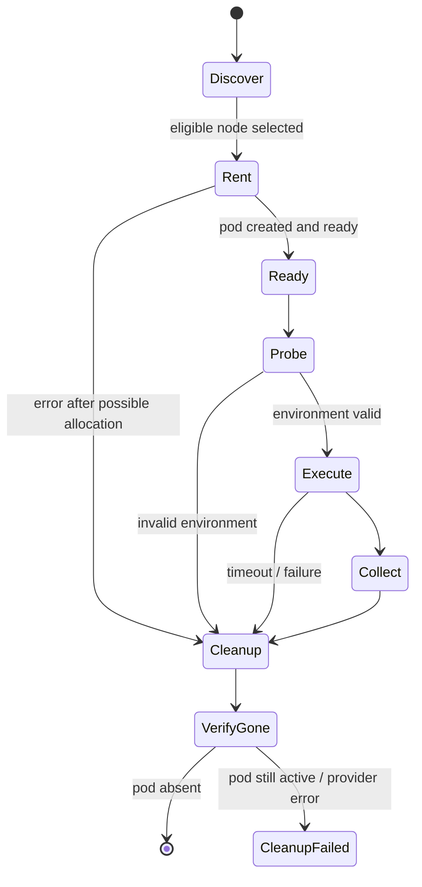

# Lium provider workflow

Lium is the first ephemeral GPU provider targeted by ServeBisect. The integration should use the normal Lium CLI lifecycle and keep every allocation bounded by both automatic and explicit cleanup.

The commands below were checked against the public Lium documentation on 2026-09-17. Lium evolves independently of ServeBisect, so scripts should still validate the installed CLI version and fail clearly when an expected flag is unavailable.

References:

- <https://docs.lium.io/developers/agent-scripting>
- <https://docs.lium.io/developers/cli/reference/up>
- <https://docs.lium.io/developers/cli/reference>

## Current ServeBisect commands

The PoC exposes discovery, single-command, and same-pod comparison workflows:

```bash
servebisect lium doctor --gpu H100 --count 1
```

`doctor` checks that the `lium` executable is available, verifies authentication with `lium balance --json`, lists nodes with `lium ls --format json`, filters by GPU type/count, computes the requested hourly price from per-GPU pricing when necessary, sorts by that requested price, and prints up to ten matches.

To execute one bounded remote command:

```bash
servebisect lium run \
  --gpu H100 \
  --count 1 \
  --ttl 45m \
  --max-hourly-price 3.00 \
  --setup "python -m pip install -U vllm" \
  --command "nvidia-smi"
```

For regression measurements that must share the same physical pod, `lium compare` can upload local benchmark files and execute a baseline/candidate pair before teardown:

```bash
servebisect lium compare \
  --gpu A100 \
  --count 1 \
  --ttl 20m \
  --max-hourly-price 0.35 \
  --upload ./benchmark.py:/tmp/benchmark.py \
  --baseline-command "python3 /tmp/benchmark.py --variant good" \
  --candidate-command "python3 /tmp/benchmark.py --variant bad" \
  --metric throughput \
  --direction higher \
  --max-regression-pct 5 \
  --json report.json \
  --markdown report.md
```

Uploads use `lium scp` with the stable pod selector. Both commands execute before the one cleanup/verification cycle, so provider and GPU identity are shared by the comparison.

The current wrapper requires Lium CLI `0.0.42` or newer, chooses the cheapest matching node, rejects it when it exceeds `--max-hourly-price`, runs `lium up <node-id> --count <count> --name ... --ttl ... --yes --no-ssh`, finds the uniquely named pod with `lium ps --format json`, optionally uploads files and runs setup, executes requested commands with `lium exec --json`, and calls `lium rm` from a `finally` block after a successful rent. If `lium up` returns non-zero after a pod was created, it reconciles by unique run name and attempts removal. Removal itself is verified against fresh `lium ps --format json` state.

## Authentication

For non-interactive automation, provide a Lium API key through the environment or the provider's normal credential store. Lium's agent-scripting documentation notes that `lium init` is an interactive/human-approval path when a key is not already available, so ServeBisect should not try to bootstrap browser authorization inside a CI job.

Before renting a GPU, an operator can verify authenticated account state with:

```bash
lium balance --json
```

Do not write the API key into a ServeBisect config file, generated shell script, report, or CI artifact.

## Discover nodes

Use structured output for node selection:

```bash
lium ls --format json
```

The JSON includes fields such as the node `id`, human-readable identifier, GPU type/count, location, and hourly pricing. For automation, prefer the returned `id` as the argument to `lium up`; the human-readable value shown in tables can be confused with other selectors across CLI versions.

A controller can filter the JSON to enforce policy before any allocation:

- exact or allowed GPU models;
- GPU count;
- maximum hourly price;
- country/region constraint if required;
- minimum CPU or port capacity;
- provider-reported capabilities needed by the workload.

The selection decision should be captured in the run metadata together with the quoted hourly price.

## Rent with a bounded lifetime

The non-interactive rent flow is:

```bash
lium up <node-id> \
  --count 1 \
  --yes \
  --no-ssh \
  --ttl 45m \
  --name servebisect-<run-id>
```

Useful filters can also be supplied directly, for example `--gpu H100` or `--count 1`.

Three flags matter for automation:

- `--yes` prevents a confirmation prompt;
- `--no-ssh` returns control to the caller instead of opening an interactive SSH session;
- `--ttl` schedules automatic removal after a bounded duration.

The TTL is a safety net. A successful ServeBisect run should still delete the pod as soon as work completes.

`lium up` currently does not expose JSON output. After it returns, rediscover the created pod with:

```bash
lium ps --format json
```

Use the unique run name and/or identifiers returned by `up` to bind the ServeBisect run to exactly one pod. Do not fall back to "most recent pod" when multiple controllers can share an account.

## Starting-state failures

The Lium CLI can return non-zero after a pod has already been created, for example if the pod is still starting when a timeout is reached. The error path therefore cannot assume that a failed `lium up` means no allocation exists.

For unattended automation, every `up` failure after a rent may have been attempted should trigger:

1. run `lium ps --format json`;
2. look for the unique run name / pod identifier;
3. record its status, hourly price, and scheduled-removal field if present;
4. remove it unless the controller has an explicit reason to retain it for debugging;
5. verify that the pod disappears from the active listing.

The current wrapper implements this named-pod reconciliation path. A controller process that is killed before it can execute cleanup still needs a separate orphan-reconciliation mechanism; the TTL remains the provider-side backstop for that case.

## Execute commands

Lium provides non-interactive remote execution through `lium exec`:

```bash
lium exec <pod> --json "nvidia-smi"
```

Current JSON output has an overall success indicator and per-pod result fields such as exit code, stdout, stderr, and error information. ServeBisect should preserve the remote exit code separately from transport failures so a test command that exits `1` is distinguishable from an SSH/provider failure.

Typical bootstrap probes include:

```bash
lium exec <pod> --json "python --version"
lium exec <pod> --json "nvidia-smi --query-gpu=name,driver_version,memory.total --format=csv,noheader"
```

Remote stdout/stderr should be treated as sensitive until scrubbed because inference workloads can print prompts, repository paths, tokens, or environment-derived values.

## Transfer only what the run needs

The Lium CLI also exposes `scp`/`rsync` flows for moving payloads. ServeBisect should prefer a small, explicit run bundle over copying an entire developer checkout. A run bundle can contain:

- the test harness or install script;
- public fixtures;
- pinned dependency metadata;
- a generated run ID and non-secret plan.

Private models, repositories, or datasets need their own credential handling and should not be copied merely because the parent working directory is convenient.

## Observe spend during a run

Current `lium ps --format json` output includes fields for hourly price, uptime/spend, and scheduled removal. Long-running or repeated bisects should periodically re-read those values and stop before exceeding the ServeBisect run budget. The current `servebisect lium run` command enforces an optional pre-rent `--max-hourly-price` ceiling, but it does not yet implement a total-spend ceiling or periodic spend polling.

For an account-level view:

```bash
lium balance --json
```

Budget enforcement should be based on a configured ceiling plus provider-reported price/spend. It should not depend only on a locally estimated timer because pod startup and teardown time may still be billable.

## Teardown

Always attempt explicit teardown:

```bash
lium rm <pod>
```

Then verify:

```bash
lium ps --format json
```

The pod should no longer appear as active. If removal fails, surface cleanup failure prominently with the pod identifier and the safest manual command to retry. Do not hide cleanup failure behind a successful regression result. The PoC wrapper currently polls fresh provider state up to three times after `lium rm` and raises an error if the pod is still active.

The cleanup logic should be idempotent: a second cleanup attempt against an already-removed pod should not turn a completed run into a regression failure.

## Recommended controller state machine



## Provider invariants

The Lium integration should enforce these properties regardless of the inference engine being tested:

- every allocation has a unique ServeBisect run name;
- every allocation carries a TTL;
- every allocation records its provider/pod identifiers and quoted price;
- a provider failure is never silently classified as an engine regression;
- teardown runs from success and failure paths;
- teardown is verified against fresh provider state;
- credentials never enter run artifacts;
- a dry-run or plan-inspection command never calls `lium up`.
